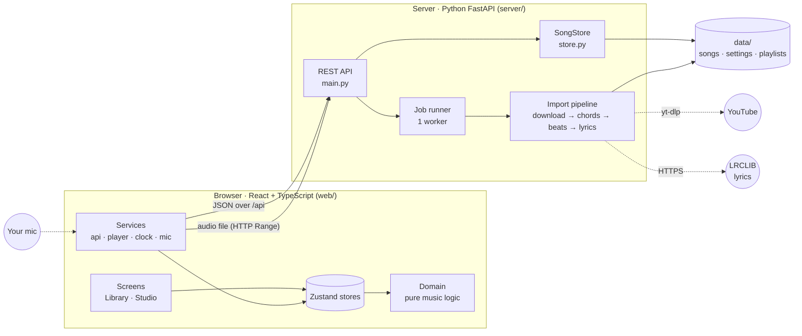
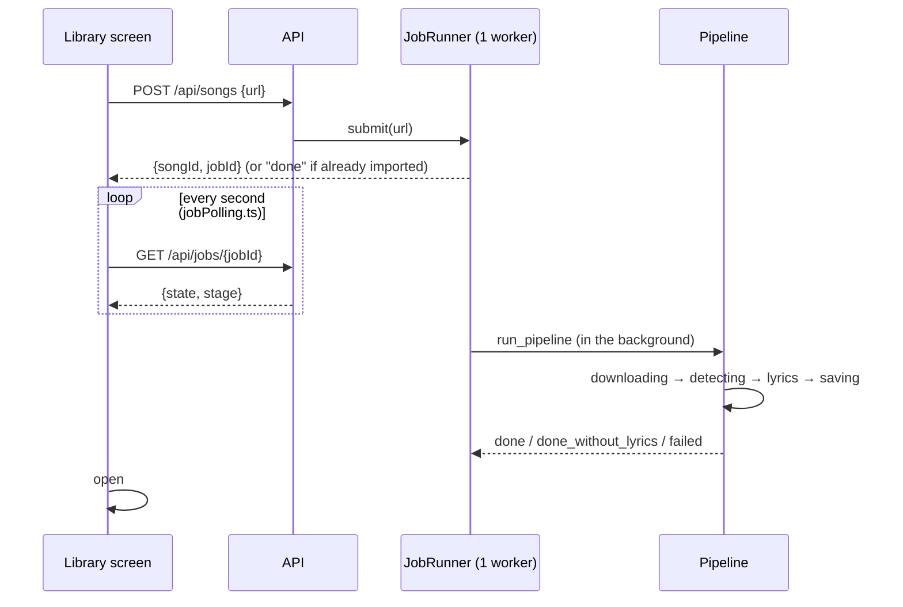
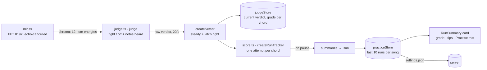

# piano-chords: how it's built

What every part of the app does and how the parts talk to each other, as the code stands on
7 Nov 2026. For *why* things were designed this way, see [LLD.md](LLD.md). It was written before
the code, so where the two disagree (Play mode and the Now/Next card, for example, are gone),
this file is right.

---

## 1. The big picture

Two programs and a folder:



| Part | Job |
|---|---|
| **Server** | The heavy, one-off work per song: download the audio, run the chord model and beat tracker, fetch lyrics. Then it's a thin file store: read and save songs, settings and playlists, and stream audio. |
| **Browser** | Everything you see and touch: playback, transposing, the chart, editing, undo, the mic checking and practice scores. It works from the song file and never calls a model. |
| **`data/`** | All your data, as plain JSON and audio files. Copy the folder and everything moves with it. |

There's no database and no login. The two programs run side by side (`npm run dev` at the repo
root starts both; Vite forwards `/api` to the server on port 8000).

---

## 2. A song's life, end to end

### 2.1 Import: paste a link → a playable song



What `run_pipeline` (`server/app/pipeline.py`) does, step by step:

| Step | Code | What happens |
|---|---|---|
| 1. Download | `audio.py · YtDlpFetcher` | yt-dlp fetches the audio (`audio.m4a`) and title/artist/duration. The YouTube video id becomes the song id. |
| 2. Prepare | `audio.py · to_analysis_wav` | Converts to a mono 22.05 kHz WAV for the models, using the ffmpeg bundled with `imageio-ffmpeg`. Deleted afterwards. |
| 3. Chords | `detect.py · LvChordiaDetector` | The lv-chordia model (PyTorch, CPU) returns timed chords in Harte format (`C:min`). `labels.py · normalize_label` turns them into app labels (`Cm`). |
| 4. Tidy | `pipeline.py · merge_slivers` | Folds chords shorter than 0.1 s into their neighbour. |
| 5. Beats | `detect.py · detect_beats` | librosa's beat tracker, with a fix for riffs that fool it (a 3-3-2 riff read as 4/3 of the real tempo; see `pick_tempo`). |
| 6. Refine | `refine.py · refine_timing` | (a) `fill_long_segments`: re-checks suspiciously long chords and "silent" stretches that actually have sound, half a bar at a time. (b) `refine_boundaries`: moves each chord change to the beat where the audio fits the old and new chords best. Chord names are never changed here. |
| 7. Save raw | `store.write_detected` | `detected.json`: the model's output, never edited afterwards. |
| 8. Lyrics | `lyrics.py · LrclibLyrics` | Searches LRCLIB with a cleaned-up title (drops "(Official Video)" and similar), picks the closest duration, and parses line-timed LRC. Not finding lyrics is fine. |
| 9. Assemble | `pipeline.py · assemble` | Builds `song.json`: chords with a **confidence** (the model gives none, so chords shorter than two beats count as "unsure" and get flagged for review), beats and lyrics. The key isn't stored: the browser estimates it on load. |

### 2.2 Open a song: the studio

`StudioScreen` calls `openStudio()` (`web/src/state/studioSession.ts`), which:

1. fetches `song.json` and converts it from the wire format (`api.ts · fromWire`: label strings become `Chord` objects, and the key is estimated from how long each chord plays),
2. puts it in **songStore**,
3. loads the audio into the **player** (one `<audio>` element),
4. starts the **clock** (a `requestAnimationFrame` loop that reads the player's time into
   **playbackStore**, and handles looping),
5. starts **autosave**.

Closing (Back, or switching song) undoes all of that. It's safe to call at any point, even
halfway through loading.

### 2.3 Edit a chord

```
click a chord ──▶ ChordPopover ──▶ songStore.apply(edit)          edit = pure (song) => song from domain/edits.ts
                                       │  pushes the old song onto the undo stack (100 deep)
                                       │  bumps `revision`
                                       ▼
                          autosave sees the revision change ──▶ waits 800 ms ──▶ PUT /api/songs/{id}
                                                                (flushed with keepalive if you close the tab)
```

Edits are always made in the key you're viewing and stored in the song's original key
(`setChordFromDisplay` transposes back), so transposing never changes the file.

### 2.4 Practise: mic → grade → score



---

## 3. Server, file by file (`server/app/`)

| File | Does |
|---|---|
| `main.py` | The FastAPI app and every route. Builds the real dependencies (`Deps`) unless a test passes fakes. Reads `PC_DATA_DIR`. |
| `jobs.py` | `JobRunner`: in-memory jobs on a single worker thread (the model needs the whole CPU). Re-submitting a song that's already imported returns "done" at once. Jobs are lost on restart, but finished songs are on disk. After an import finishes it queues a follow-up job on the same thread that splits the song into mixes (`stems.py`), so the song is playable first and the mixes appear later. |
| `stems.py` | Demucs splits the audio into stems and saves three mixes in `mix/`: `backing` (vocals, drums and bass, without the piano and other instruments), `novocals` (drums, bass, other) and `vocals`; then sets `song.mixes`. |
| `pipeline.py` | `run_pipeline` (§2.1), `merge_slivers`, `estimate_confidence`, `assemble`. `Deps` bundles every swappable part. |
| `audio.py` | `video_id` (accepts every YouTube link shape), `YtDlpFetcher`, `to_analysis_wav`. |
| `detect.py` | `ChordDetector` protocol and `LvChordiaDetector`; `detect_beats` and the tempo fix. `PC_DETECTOR` picks the model. |
| `labels.py` | `normalize_label`: model labels → app labels. The browser never sees a model's format. |
| `refine.py` | Chord-change timing: `fill_long_segments`, `refine_boundaries`. Measured against `eval/`. |
| `align.py` | Word-level lyric timing: `CtcAligner` (Meta MMS ONNX forced aligner, model cached in `~/.cache/piano-chords/`) times each word inside its line's window; a line keeps `words` only if it passes a confidence gate. `align_song` runs after import and when lyrics change. |
| `lyrics.py` | LRCLIB client: title cleaning, several search attempts, pick by duration, LRC parsing. |
| `store.py` | `SongStore`: the data folder. `update_song` takes the per-song lock and keeps the fields only the server writes (`keep_server_fields`, e.g. `mixes` and a lyric line's `words`), so a browser autosave can't erase them. Reads and writes song, detected, settings and playlist files atomically; the library list includes `chordTime` (seconds per chord) so the browser can show keys without loading each song. |

### API

| Method | Path | Does |
|---|---|---|
| POST | `/api/songs` `{url}` | Start an import. Returns `{songId, jobId}`. |
| GET | `/api/jobs/{id}` | Import progress: `{state, stage, error?}`. |
| GET | `/api/songs` | Library list: id, title, artist, duration, `chordTime`, `hasLyrics`. |
| GET / PUT | `/api/songs/{id}` | Read or save a song (the whole `song.json`). |
| DELETE | `/api/songs/{id}` | Delete the song folder and remove it from playlists. |
| GET | `/api/songs/{id}/audio` | The audio file, with Range support so seeking works. |
| GET | `/api/songs/{id}/mix/{name}` | One saved mix (`backing`, `novocals` or `vocals`), with Range support like `/audio`. 404 if it hasn't been made. |
| GET | `/api/songs/{id}/cover` | YouTube thumbnail, fetched once and cached in the song folder. |
| POST | `/api/songs/{id}/lyrics` `{title, artist}` | Search LRCLIB again. Only searches: the browser applies the result as an undoable edit, so a slow search can't overwrite your edits. |
| GET / PUT | `/api/playlists` | All playlists, saved as a whole. |
| GET / PUT | `/api/settings/{name}` | One named settings value (a JSON string). The browser's persisted stores use this. |

### The data folder

```
data/                               (server/data by default; PC_DATA_DIR moves it)
  settings.json                     { "piano-chords:view": "...", "piano-chords:practice": "..." }
  playlists.json
  songs/<youtubeId>/
    audio.m4a                       the download
    cover.jpg                       thumbnail
    mix/                            backing, no-vocals and vocals-only audio (from stems.py)
    detected.json                   raw model output, never edited
    song.json                       the song, with your edits (original key)
    song.json.bak, .beats.bak       backups left by the redo scripts
```

### Scripts and measurement

| Path | Use |
|---|---|
| `scripts/redo_chords.py <id>` | Redo chord timing from `detected.json` with the current refine steps. Replaces your chord edits; backs up first. |
| `scripts/redo_beats.py <id>` | Redo beats only. Keeps chords and edits. |
| `scripts/backfill.py` | Make mixes for songs imported before stems existed. Skips songs that already have them. `--align <ids>` adds word times to lyrics. |
| `eval/timing_synthetic.py` | Synthesised songs with known change times: how accurate chord-change timing is. |
| `eval/align_synthetic.py [stems dir]` | macOS `say` speaks each word at known times: word-timing accuracy (7 Nov: median 67 ms, 96% within 150 ms). |
| `eval/timing_real.py`, `eval/fill_real.py` | Effect of the refine steps on your real imports. |
| `eval/fetch_ug.py` | Fetch Ultimate Guitar charts for comparison (cached in `data/eval/`, never committed). |

---

## 4. Browser, layer by layer (`web/src/`)

```
ui/          drawing-only components (no stores)       ─┐
features/    screens and panels                         │  may use anything below
state/       Zustand stores + session/autosave          │
services/    the outside world: server, audio, mic, time│
domain/      pure functions and types                  ─┘  imports nothing above, no React
```

The rule: **domain knows nothing about React, stores or the server.** That's why most of the
tests are plain function tests.

### 4.1 `domain/`: the music logic (pure)

| File | Does |
|---|---|
| `music.ts` | Chords as pitch classes. `parseChord` / `formatChord`, `transposeChord`, `simplifyChord` (easy = plain triads), `chordPitchClasses` (via `tonal`), `displayChord` (simplify → transpose → spell sharps/flats for the key), `estimateKey`. |
| `song.ts` | The `Song` type (chords, beats, lyrics, anchors; always in the original key) and `validate`. |
| `edits.ts` | Every edit as a pure `(song) => song`: set, confirm, move the start, split, merge, delete, move an anchor. |
| `timing.ts` | `activeChordIndex` (binary search), `beatIndex`, `isUnsure` / `reviewQueue` (flagged chords), `loopSeekTarget`, `computePeaks` (waveform). |
| `align.ts` | Places chords over lyric words. Lines are timed; words are too when the server aligned them (`words`), otherwise the position within a line is estimated from time. Manual anchors win. |
| `leadSheet.ts` | Turns aligned rows into chart lines: chord-only stretches become bars of four, and repeated lines collapse to `×N`. |
| `voicing.ts` | Chord → keys to press within your keyboard's range. Two strategies: `nearestInversion` (hand moves least) and `rootPosition`. `rankKeys` orders keys by how many chords need black keys. |
| `suggest.ts` | When fixing a chord: the song's own chords, most-played first. |
| `judge.ts` | Mic checking. `chromaFromSpectrum` (FFT → 12 note energies, overtones discounted), `judge` (right / off and which notes were heard), `createSettler` (steadies readings and latches "right" for the chord). |
| `score.ts` | Practice scoring. `createRunTracker` (one attempt per chord while playing), `judgementFor` (Perfect / Great / Good / Late; windows scale with tempo via `beatSeconds`), `summarize`, `letterFor`, `tipsFor`. |
| `sections.ts` | `findSections` (verse/chorus from repeated lyrics; derived, never stored), `sectionAt`. |
| `mastery.ts` | Per-chord skill level from your practice runs (`mastery`), songs you can play now (`playableSongs`), the chord to learn next (`nextToLearn`). |
| `playlists.ts` | Playlist edits, `nextSong`, `songKeySummary` (key and easiest key from `chordTime`). |
| `profile.ts`, `instruments.ts` | Your settings as a player (instrument, key range, difficulty, voicing, note names) and the instrument registry (piano only; range defaults to F3–C6). |

### 4.2 `services/`: talking to the outside

| File | Does |
|---|---|
| `api.ts` | The only code that calls the server. Converts between the wire format (chord label strings) and `Chord` objects in `fromWire` / `toWire`. |
| `player.ts` | The `Player` interface and the `<audio>` implementation. Speed changes keep the pitch (`preservesPitch`). |
| `clock.ts` | The heartbeat: each animation frame it reads the player's time, applies the loop, and publishes the time. |
| `mic.ts` | Opens the mic (echo cancellation on, so the song from your speakers is removed; noise suppression and auto gain off) and returns chroma when you're louder than the room, which it measures as it goes. |
| `jobPolling.ts` | Polls an import job once a second; stops and reports on any error. |
| `waveform.ts` | Decodes the audio in the browser for the waveform peaks. |

### 4.3 `state/`: the stores

| Store | Holds | Saved? |
|---|---|---|
| `songStore` | The open song, undo/redo stacks, save state. `apply(edit)` is the only way to change it. | Yes: autosave PUTs the song (`subscribeAutosave`). |
| `viewStore` | Your profile, per-song transpose, volume, selected chord. | Yes: `settings.json` → `piano-chords:view`. |
| `playbackStore` | Time, playing, speed, loop, the wait-for-me `gate` and `waiting`. `time` changes 60 times a second. | No. |
| `judgeStore` | Mic on/off, `waitMode`, level, current verdict, grade per chord this session. | No. |
| `practiceStore` | Runs per song (last 10), live score, the open summary card. | Yes: `settings.json` → `piano-chords:practice`. |

`settingsStorage.ts` connects the saved stores to `/api/settings` (and picks up anything saved in
the browser by older versions). `studioSession.ts` is §2.2.

### 4.4 `features/`: what's on screen

| Folder | Components |
|---|---|
| `library/` | `LibraryScreen`: add a song, song cards (with key, easiest key and a "You can play this" badge), the "Your chords" panel, playlists. `JobProgress`: the import progress. |
| `studio/` | `StudioScreen` (layout and lifetime), `StudioHeader` (back, title, playlist "Next", Check my playing, Key), `display.ts` (hooks turning the song into what's shown: labels, voicings, active chord), `useShortcuts`. |
| `timeline/` | `Timeline`: the scrolling waveform, section band (click loops a section), chord lane and lyric lane with the playhead fixed in the middle. Drag to move through the song, drag a chord's left edge to move the change, click to select. |
| `editor/` | `EditBar` (undo/redo, flagged chords "Next"), `ChordPopover` (fix a chord: the song's chords first, root/type picker under "More"), `LyricsFinder`. |
| `chart/` | `ChartPreview` (chords over lyrics, or lead-sheet bars; follows playback), `ChordChip` (hover to see the keys). |
| `judge/` | `PracticeToggle`, `PracticeStrip` (the mic loop, target notes, verdict, live score), `RunSummary` (the run card). |
| `player/` | `PlayerBar`: play, time, scrubber, loop this change, volume, speed, and Mix (full song, backing track, no vocals, vocals only; shown only when the song has `mixes`). `switchMix` reloads the audio and keeps position, speed and play state; the choice is remembered per song in `viewStore`. |
| `transpose/` | `KeyMenu`: keys ranked easiest first, difficulty, voicing, note names. |
| `instrument/` | `diagrams.ts`: instrument → drawing (piano → `Keyboard`). |

`ui/` holds the drawing-only pieces: `Keyboard`, `RootPicker`, `ChordName` (♭/♯ glyphs).

Screens are chosen by the URL hash in `App.tsx`: `#/` library, `#/song/<id>` studio,
`#/playlist/<id>` and `#/playlist/<pid>/song/<id>` (studio, carrying on through a playlist).

---

## 5. Mechanisms worth knowing

**Wait-for-me is a gate in the clock.** The rules are `waitAction` in `timing.ts`.

**Transposing is a view, not an edit.** The stored song stays in its original key. Every label on
screen goes through `displayChord` (simplify → transpose → spell for the new key), via
`useDisplay()` in `features/studio/display.ts`. The mic checking uses the same `played()` path,
so it always grades the chord you're shown.

**Sixty updates a second without re-rendering everything.** Components never subscribe to raw
time. They subscribe to derived values (`useActiveIndex`), which change once per chord. The
timeline moves by a CSS transform set outside React. Only the scrubber, playhead and practice
loop read time directly.

**The server and browser each translate at their edge.** Models speak Harte labels; the server
translates them (`labels.py`). The server speaks label strings; the browser translates them
(`api.ts`). Inside the browser, everything is `Chord` objects.

**Swappable parts sit behind small interfaces where a second version is real:** `ChordDetector`,
`AudioFetcher` and `LyricsProvider` on the server (tests use fakes for all three); `Player`,
voicing strategies and the instrument registry in the browser.

**The mic checking in short:** the FFT is folded into 12 note energies; peaks at whole multiples
of a lower note count less, because they're mostly overtones. "Right" means the chart's notes
(the 5th may be left out) or any chord on the right root. A grade must repeat across a few
readings before it shows. Once you get a chord right it stays right until the chord changes.

---

## 6. Where to change things

| You want to… | Change |
|---|---|
| Try another chord model | A new `ChordDetector` in `detect.py`, its rows in `labels.py`, `PC_DETECTOR=<name>`. |
| Fix an imported song's beats or timing | `scripts/redo_beats.py` (keeps edits) or `scripts/redo_chords.py` (replaces edits). |
| Make mic checking more or less sensitive | `MIN_DB` / `GATE_DB` in `services/mic.ts`; `ON_RATIO` / `EXTRA_RATIO` in `domain/judge.ts`. |
| Make scoring stricter or looser | `WINDOWS` and `DETECT_SEC` in `domain/score.ts`. |
| Change your keyboard's range | `defaultRange` in `domain/instruments.ts`. |
| Add a chord edit | A pure function in `domain/edits.ts`, a test in `edits.test.ts`, then call it through `songStore.apply`. |
| Add an API route | `server/app/main.py`, a method on `api` in `services/api.ts`, a test in `tests/test_api.py`. |
| Add an instrument | An entry in `domain/instruments.ts` and a drawing in `features/instrument/diagrams.ts`. |
| Keep the data elsewhere (e.g. iCloud) | Start the server with `PC_DATA_DIR=<folder>`. |

---

## 7. Tests

| Where | Covers |
|---|---|
| `web/src/domain/*.test.ts` | Music theory round-trips, edits keep the song valid, alignment, voicing, timing, playlists, chord suggestions, judging (synthetic piano spectra with overtones), scoring, run tracking and tips. |
| `web/src/state/*.test.ts`, `services/*.test.ts` | Undo/redo and autosave, settings storage, studio session lifetime, wire format, job polling. |
| `web/src/eval/ugBenchmark.test.ts` | Skipped by default: compares imports against Ultimate Guitar charts. |
| `server/tests/` | Label conversion, lyrics parsing and title cleaning, link parsing, timing refinement, the tempo fix, and the pipeline and API end to end with fake fetcher, detector and lyrics. |

Run: `cd web && npm test` · `cd server && uv run pytest`.
