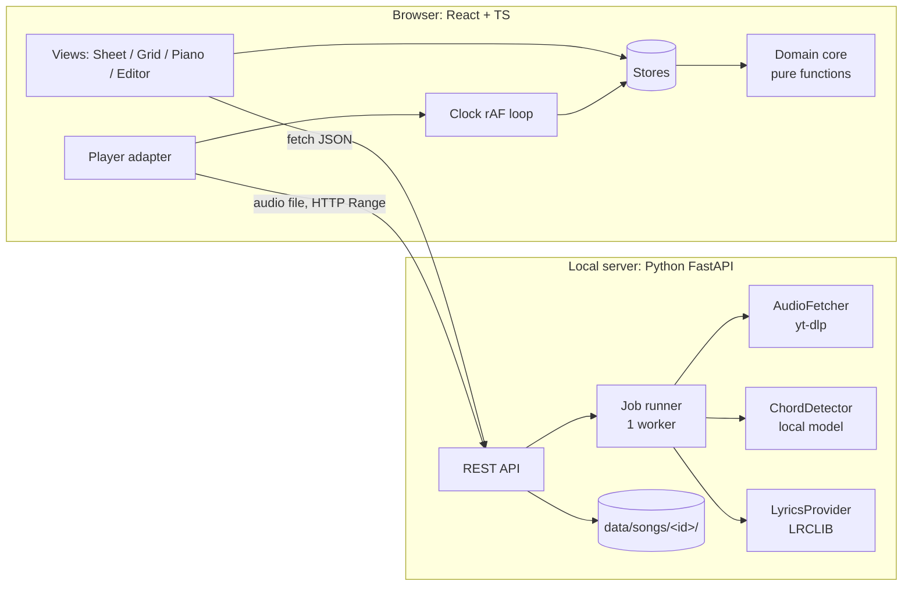

# piano-chords: low-level design

Status: draft for review (31 Oct 2026). Nothing is built yet.
Read with [REQUIREMENTS.md](../REQUIREMENTS.md).

Each decision is written as **forces → options → choice → name**. The pattern name comes
last on purpose: the forces are what make a pattern right, and the name is only a label.
Where you see **Try first**, answer it yourself before opening the answer.

---

## 0. Why there's almost no HLD

One user, one laptop, no scaling, no uptime target. The only system-level problem is a
**long job**: downloading the audio and detecting chords takes 30s to 2min, and the browser
must not sit waiting on one HTTP request. Everything else is LLD.



**Stack (my defaults; change any of these):** React + TypeScript + Vite, Zustand for state,
`tonal` for music theory, a Python FastAPI server (the chord models are Python), JSON files
on disk instead of a database.

---

## 1. The one rule: data flows one way

```
stored Song (original key, detected + your edits)
        │  pure functions: simplify → transpose → spell → align → voice
        ▼
what you see (chart lines, grid cells, piano keys)
```

The stored song is never changed by *viewing* it. Transpose, difficulty, and sharps vs
flats are **view settings**, not edits.

### Decision 1: is transposing an edit or a view?

> **Try first:** You transpose Fm → Am, then fix one wrong chord (you type `G`).
> What exactly gets written to disk, and what breaks if you get this wrong?

<details><summary>Answer</summary>

Disk holds the song in its **original key**. Your `G` (typed in the Am view, +4 semitones)
is transposed back by −4 and saved as `Eb`.

If you saved transposed chords instead, the song would be half in Fm and half in Am, and
the next transpose would apply on top of an already-transposed chord. Every view setting
would become a migration.

Forces: one source of truth, view settings reversible for free.
Name: **derived state** (or "functional core, imperative shell"): store the minimum and
compute the rest.
</details>

### The transform pipeline

```ts
// domain/music.ts: every step is Chord -> Chord, so steps compose
const display = (c: Chord, v: ViewSettings) =>
  spell(transpose(simplify(c, v.difficulty), v.semitones), v.spelling, targetKey(v));
```

- `simplify`: easy mode turns `Fm7` into `Fm` and `Dbsus2` into `Db`. Plain triads only.
- `transpose`: moves pitch classes. Uses `tonal`.
- `spell`: picks `A#` or `Bb` for the target key. It must run **last**, because the right
  spelling depends on the key you end up in.

A new view feature (capo, Nashville numbers, solfège) is one more function in this chain.
No other code changes. That is the whole extensibility story for display.

---

## 2. Domain core (pure TypeScript, no React)

```ts
type PitchClass = 0|1|2|3|4|5|6|7|8|9|10|11;
type Quality = 'maj'|'min'|'dim'|'aug'|'sus2'|'sus4'|'7'|'maj7'|'min7'|string; // open for growth
type Chord = { kind: 'chord'; root: PitchClass; quality: Quality; bass?: PitchClass }
           | { kind: 'none' };                                    // "N.C.", silence

type ChordEvent = { id: string; start: number; end: number; chord: Chord }; // seconds
type LyricLine  = { id: string; start: number; end: number; text: string };

type Song = {
  id: string;               // youtubeId
  title: string; artist: string;
  originalKey: string;      // e.g. "Fm"
  beats: number[];          // beat times in seconds, for the grid view
  chords: ChordEvent[];     // sorted by start, no overlaps (invariant)
  lyrics: LyricLine[];      // may be empty: lyrics are optional
  anchors: Record<string, { lineId: string; charIndex: number }>; // your manual placements
};

type ViewSettings = {
  semitones: number;                    // -11..+11
  difficulty: 'easy' | 'full';
  spelling: 'auto' | 'sharps' | 'flats';
  voicing: 'nearest' | 'root';
  view: 'sheet' | 'grid';
};
```

`Chord` is a **discriminated union**: TypeScript forces every function to handle "no chord".
Nobody has to remember a null check.

### Decision 2: putting chords above the right word

LRCLIB gives a timestamp per **line**, not per word. Chords have their own timestamps.

```ts
// domain/align.ts
alignChart(song): ChartRow[]
// ChartRow = { kind: 'lyric', line, chords: { event, charIndex }[] }
//          | { kind: 'instrumental', chords: ChordEvent[] }   // chords between lines
```

Heuristic: `charIndex = (chord.start - line.start) / (line.end - line.start) × text.length`,
snapped to the nearest word start. A chord you drag to a different word is saved in
`anchors`, and an anchor always wins over the heuristic.

Tradeoff: this is wrong when a singer holds one word for a long time. That's acceptable
because you can drag the chord, and you only fix each one once. Upgrade path: word-level
timing (forced alignment) later, behind the same `alignChart` signature.

### Decision 3: which piano keys to show

Forces: there are only 32 keys, and you're a beginner. Your practice log says that when
you switch chords you press neighbouring keys by accident. The less your hand moves, the
fewer of those mistakes.

> **Try first:** Play C → Am → F → G. Count the total semitones your fingers travel
> (a) with every chord in root position, and (b) choosing whichever inversion is closest
> to the previous chord.

<details><summary>Answer</summary>

(a) Root position: C-E-G → A-C-E (10) → F-A-C (11) → G-B-D (6) = **27 semitones**, and the
whole hand jumps on every change.

(b) Nearest inversion: C-E-G → C-E-A (only G→A moves, 2) → C-F-A (only E→F moves, 1) →
B-D-G (6) = **9 semitones**. Two fingers stay put on every change.

That's why "nearest" is the default.
</details>

```ts
// domain/voicing.ts
type Voicer = (chord: Chord, prev: Voicing | null, range: KeyRange) => Voicing;
const rootPosition: Voicer = ...;
const nearestInversion: Voicer = ...;   // minimises total movement from prev, stays in range
```

This is a real **strategy** (swap the algorithm, keep the call site). Here it's justified
because both versions exist on day one and you switch between them in the UI.

`KeyRange` is config, not a constant. I couldn't verify the SA-51's exact lowest and highest
notes; it has 32 keys, but which notes they start and end on is unconfirmed. Set it once
from the real keyboard.

---

## 3. Playback: the clock problem

Forces: the chart highlight, grid cursor, piano strip, auto-scroll and section loop all
need "what time is it in the song". The audio element only tells you when you ask
(`currentTime`). If the whole chart re-renders 60 times a second, it will stutter.

```ts
// services/player.ts: the only code that touches the audio API
interface Player {
  load(src: string): Promise<void>;
  play(): void; pause(): void;
  seek(t: number): void;
  currentTime(): number;
  setRate(r: number): void;        // slow down without changing pitch
  setPitch(semitones: number): void;
  onEnded(cb: () => void): void;
}
```

One `Clock` runs a `requestAnimationFrame` loop. It reads `player.currentTime()`, writes it
to the playback store, and handles looping (`t >= loop.end → seek(loop.start)`). Looping
lives in the clock, not in a button component.

> **Try first:** The chart has 300 chord chips, and the clock updates 60 times a second.
> How do you stop 300 components re-rendering 60 times a second?

<details><summary>Answer</summary>

Components never subscribe to `time`. They subscribe to a **derived** value,
`activeChordIndex` (binary search over chord start times), and the store only notifies
when that value changes. A chord changes every 1 to 2 seconds, and then exactly two chips
re-render: the one losing the highlight and the one gaining it (`React.memo` keyed on
`isActive`). The scrubber is the only thing that reads raw `time`.

Name: **observer** (via store selectors), plus **derived selectors** to throttle updates
by meaning instead of by a timer.
</details>

### Decision 4: play the downloaded audio, not the YouTube embed

The server downloads the audio anyway, so the detector can analyse it. Playing that same
file has four advantages:

- Chord timestamps match exactly, because it's the same audio the detector heard. YouTube
  ads and imprecise seeking would shift them.
- **Pitch shift** becomes possible. If you transpose to Am but the recording stays in Fm,
  playing along sounds wrong, unless the keyboard itself transposes (see open question 1).
- Slowing down, looping and offline use all work.
- `Player` is an interface, so a `YouTubePlayer` for when you want the video is a
  second implementation, not a rewrite.

Name: **adapter**. The rest of the app speaks `Player`, not `HTMLAudioElement` or the
YouTube iframe API.

---

## 4. State: three stores, split by how often they change

| Store | Holds | Changes | Saved? |
|---|---|---|---|
| `song` | `Song` + undo history | when you edit | yes, to the server |
| `view` | `ViewSettings` | when you toggle a setting | yes, per song in localStorage |
| `playback` | `time, playing, rate, loop` | 60×/s | no |

Why split: if one store changes 60 times a second, nothing that only cares about the song
should hear about it. And the three are saved differently.

### Decision 5: undo/redo

> **Try first:** Command objects (each edit knows how to undo itself) or snapshots (keep
> the previous `Song`)? Songs are around 50KB, you're the only editor, and you want maybe
> 100 undo steps.

<details><summary>Answer</summary>

**Snapshots.** Every edit is already a pure function `(song) => song`, so undo means
"remember the previous value". 100 × 50KB = 5MB worst case, and immer's structural sharing
makes it far less. There's no per-edit inverse to write, and no inverse bugs.

Commands win when you need a log of operations: syncing, collaboration, "show me what
changed". None of those apply here, so commands would be extra code for an imagined need.

Name: **memento** (snapshot history). Command was considered and rejected; that rejection
is a design decision too.
</details>

```ts
// domain/edits.ts: pure, each returns a new Song that still satisfies the invariants
setChord(song, id, chord) / shiftChord(song, id, dt) / splitChord(song, id, t)
mergeWithNext(song, id) / deleteChord(song, id) / moveAnchor(song, id, lineId, charIndex)
validate(song)   // sorted, no overlap, start < end. Checked once here, not in every caller
```

The editor shows transposed chords. On save:
`setChord(song, id, transpose(input, -view.semitones))`. That's Decision 1 in action.

---

## 5. Server

### API

| Method | Path | Does |
|---|---|---|
| POST | `/api/songs` `{url}` | Starts a job and returns `{songId, jobId}`. Idempotent: an already-analysed video returns `done` immediately. |
| GET | `/api/jobs/{id}` | `{state, stage, error?}`. The browser polls it every 1s. |
| GET | `/api/songs` | Library list |
| GET / PUT | `/api/songs/{id}` | Read or save `Song` |
| GET | `/api/songs/{id}/audio` | The audio file. **Must support HTTP Range**, or seeking won't work. |
| POST | `/api/songs/{id}/lyrics` `{title, artist}` | Re-fetch lyrics after you fix a messy YouTube title |

Polling, not SSE or websockets: for a once-per-song progress screen, 1s polling is the
simplest thing that works. Upgrade if the progress screen ever feels laggy.

### The job

```python
# job states (a tagged union, mirrored as a TS type in the browser)
queued -> running(stage) -> done
                         -> failed(stage, error)
                         -> done_without_lyrics     # partial success: still usable
STAGES = [fetch_audio, detect_chords, detect_beats, fetch_lyrics, assemble]
```

- One worker thread (`ThreadPoolExecutor(max_workers=1)`), because the model is
  CPU-heavy. Jobs are tracked in memory only; a server restart loses running jobs. That's
  fine, because finished outputs are cached on disk, so a re-run is quick.
- Lyrics failing is **not** fatal. You still get the grid view, and you can retry lyrics
  later. LRCLIB's coverage of Hindi/Punjabi songs is unverified.

### Decision 6: where interfaces earn their place

```python
class AudioFetcher(Protocol):   def fetch(self, url) -> tuple[Path, Meta]: ...
class ChordDetector(Protocol):  def detect(self, audio: Path) -> list[Segment]: ...
class LyricsProvider(Protocol): def find(self, title, artist, duration) -> list[Line] | None: ...
```

> **Try first:** Section 3 has a `Player` interface and this section has three protocols,
> but `SongRepository` or `TransposeService` interfaces are left out. What's the rule?

<details><summary>Answer</summary>

**An interface earns its place when a second implementation is real today, not
imagined.** We'll compare ChordMini, lv-chordia and autochord on your songs in week one,
so `ChordDetector` will have three implementations. `Player` gets a YouTube version.
Lyrics may come from LRCLIB or from pasted text.

A `SongRepository` would only ever write JSON files, so a plain module with
`load()`/`save()` is enough. An interface with one implementation is just indirection.
</details>

### Decision 7: keep model quirks out of the app

The models output labels like `C:min`, `A:maj7`, `N` (a format called Harte/MIREX). One
server function, `normalize_label()`, turns them into the app's format (`Cm`, `Amaj7`,
`none`). The browser never sees a model's format, so swapping models changes one function
and its test table.
Name: **anti-corruption layer**.

### Files on disk

```
data/songs/<youtubeId>/
  audio.m4a        # downloaded once
  detected.json    # raw model output, never edited: lets you "reset to detected" and compare models
  song.json        # current Song with your edits
```

---

## 6. Front-end structure

```
src/
  domain/      music.ts  song.ts  edits.ts  align.ts  voicing.ts   ← pure, fully unit-tested
  services/    api.ts  player.ts  clock.ts
  state/       song.ts  view.ts  playback.ts
  features/
    import/    UrlForm  JobProgress
    player/    PlayerBar  TransposeControl  LoopControl  SpeedControl
    chart/     SheetView  ChartRow  ChordChip
    grid/      GridView
    piano/     PianoStrip           (current + next chord)
    editor/    ChordPopover  ChordPicker  useShortcuts
  ui/          Keyboard  Button  Popover  Slider   ← no store access, props only
```

**Dependency rule:** `features → state → domain`. `domain` imports nothing from the app.
`ui/` components never touch a store, so `Keyboard` (props: notes, range, highlight) is
reused in the piano strip, the chord popover and the chord picker.

**Shortcuts (first pass):** Space play/pause · ←/→ previous/next chord · `[` `]` transpose ·
`E` edit chord under cursor · ⌘Z / ⇧⌘Z undo/redo · `L` loop current line.

---

## 7. Extensibility check: does the design hold?

| Future feature | What changes | What doesn't |
|---|---|---|
| Paste an Ultimate Guitar chart | a parser that produces a `Song` | every view |
| Capo or Nashville numbers | one function in the display pipeline | stored data, editor |
| Word-level lyric timing | inside `alignChart` | everything that calls it |
| Show the YouTube video | a new `Player` implementation | clock, stores, views |
| Better chord model | a new `ChordDetector` + its `normalize_label` rows | the browser |
| Guitar diagrams | a guitar voicer + a diagram component | domain types |
| Phone layout | CSS and layout components | domain, state |

## 8. Deliberately not doing (until a real need shows up)

Accounts, a database, Redux, websockets, a plugin system, microservices, i18n, E2E tests.

## 9. Tests (the smallest set that catches real breakage)

- `music`: transposing +n then −n is the identity for every root and quality;
  parse → format round-trips.
- `align`: chords snap to word starts, an anchor overrides the heuristic, gaps become
  instrumental rows.
- `voicing`: stays inside `KeyRange`; `nearest` never moves more than `root`.
- `edits`: every edit keeps `validate()` true.
- Server: a `normalize_label` table test, and the job pipeline run with a fake detector.

## 10. Open questions for Keshav

1. **Does your SA-51 have a transpose button?** I couldn't confirm it online. If it does,
   you can play easy Am shapes and the keyboard sounds in Fm, so no audio processing is
   needed. If it doesn't, the app has to pitch-shift the recording, which adds a WASM
   audio library and a spike to check quality.
2. Is audio-only playback fine, or do you want to see the YouTube video too?
3. For Hindi/Punjabi lyrics: romanised (`pal pal`) or Devanagari?
